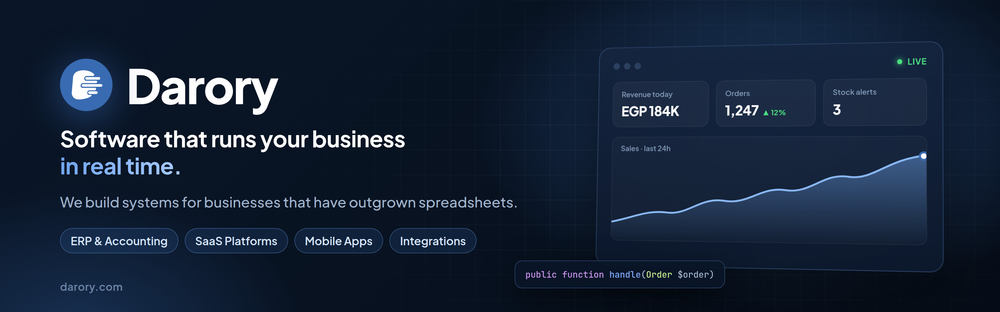

  

<h1 align="center">Darory</h1>

  <b>Software that runs your business in real time, not at the end of the month.</b> 
  ERP, accounting, SaaS and mobile apps for growing companies.

  
  
  

---

## 🧩 What We Build

| | |
|---|---|
| 🏢 **ERP & Accounting Systems** | Inventory, sales, purchasing, HR and finance in one place |
| ☁️ **SaaS Platforms** | Multi-tenant products, billing and subscriptions, built to scale |
| ⚡ **Real-time Backends** | Laravel + Livewire + Reverb for live dashboards and updates |
| 📱 **Mobile Apps** | Cross-platform Flutter apps for iOS and Android |
| 🔗 **Automation & Integrations** | WhatsApp, payment gateways, third-party APIs and workflow automation |

## 🛠️ Tech Stack

  
  
  
  
  
  
  
  
  

## 📦 Open Source

| Package | Description |
|---|---|
| [**darory/whatsapp**](https://github.com/darory/whatsapp) | Official PHP & Laravel SDK for the Darory WhatsApp API: send messages, media and locations from your app |

## 💡 How We Work

- **Real-time data**: see what's happening in your business today, not in next month's report.
- **Clean architecture**: code that is easy to maintain, test and extend as you grow.
- **Business first**: we start from your workflows and build the software around them.

## 🤝 Work With Us

Have a project in mind, or need to replace spreadsheets with a real system?

📧 **Email:** [info@darory.com](mailto:info@darory.com)  
💬 **WhatsApp:** [+20 102 298 3211](https://wa.me/201022983211)  
🌍 **Website:** [darory.com](https://darory.com)

Made with ❤️ in Egypt 🇪🇬

